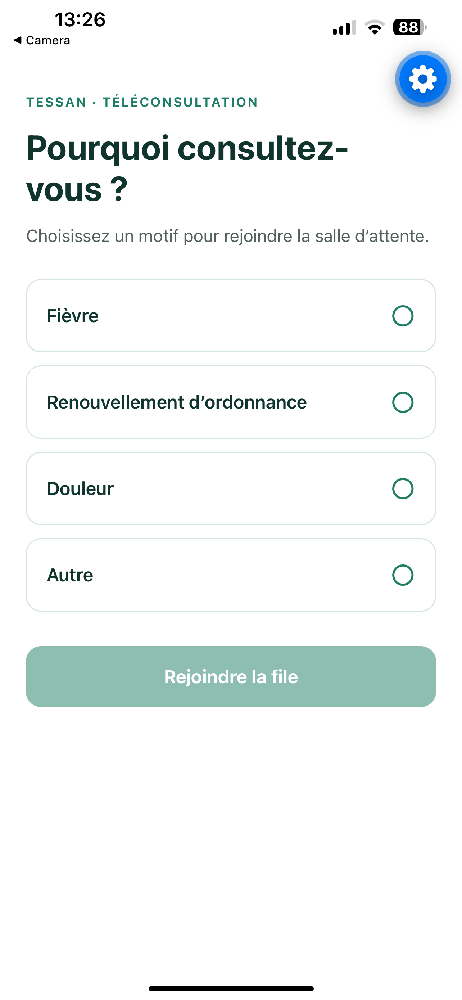
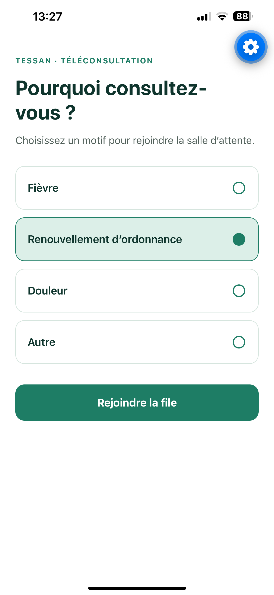
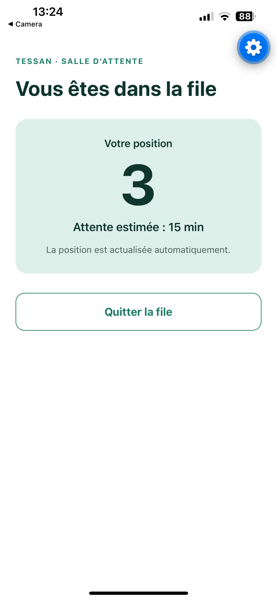
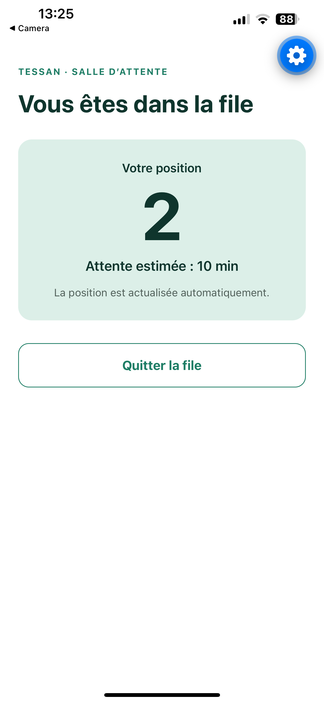
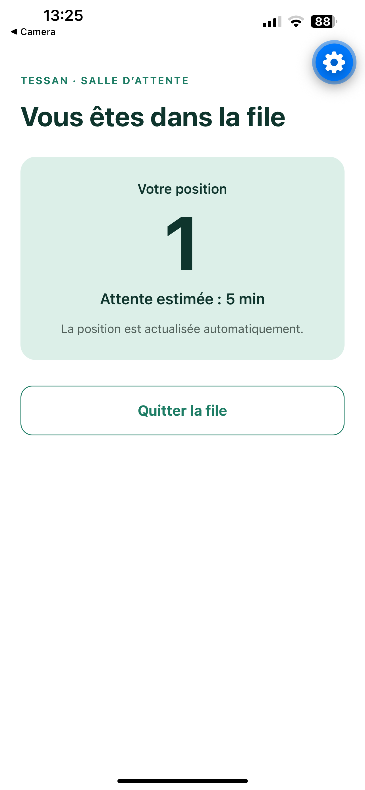
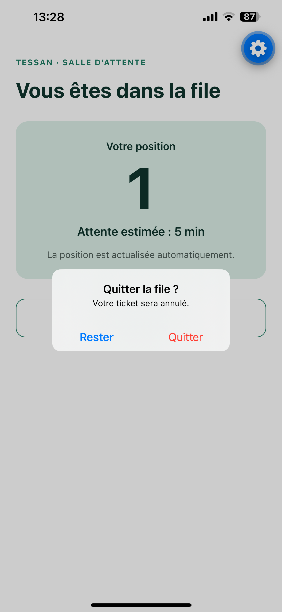

# Mini salle d’attente de téléconsultation

Deux projets TypeScript dans un même dépôt : une API NestJS dans `api/` et une application React Native avec Expo dans `app/`.

## Parcours réalisé

L’utilisateur choisit un motif, crée un ticket, voit sa position et son attente estimée, puis attend son appel ou quitte la file après confirmation. Le parcours a été vérifié sur iPhone avec Expo Go, y compris une coupure et un redémarrage de l’API.

## Captures d’écran

Captures du parcours réalisé sur iPhone : choix du motif, progression dans la file, appel du patient et état après redémarrage de l’API.

| Choix du motif | Motif sélectionné | Position 4 |
| --- | --- | --- |
|  |  |  |

| Position 3 | Position 2 | Position 1 |
| --- | --- | --- |
|  |  |  |

| Tour du patient | Confirmation de sortie | API redémarrée |
| --- | --- | --- |
|  |  |  |

## Prérequis

- Node.js 24 LTS (`nvm use` à la racine si nvm est installé)
- npm
- Pour tester sur iPhone : Expo Go et un compte Expo connecté dans l’app et dans le terminal (`npx expo login`)

## Démarrer l’API

```sh
cd api
npm ci
npm run start:dev
```

L’API écoute sur le port `3000`. La durée moyenne utilisée pour l’estimation est configurable (en minutes) :

```sh
AVERAGE_CONSULTATION_MINUTES=5 npm run start:dev
```

| Méthode | Route | Résultat |
| --- | --- | --- |
| `GET` | `/reasons` | Motifs disponibles (`id`, `label`) |
| `POST` | `/tickets` | Crée un ticket avec `{ "reason": "fievre" }` (`201`) ; accepte aussi `requestId` pour les retries |
| `GET` | `/tickets/:id` | Statut, position et attente estimée du ticket |
| `DELETE` | `/tickets/:id` | Annule un ticket en attente (`204`) |

La file commence avec trois tickets fictifs. Toutes les 20 secondes, le premier ticket `waiting` passe à `called`. Les autres avancent d’une place. Un ticket `called` ou `cancelled` reste consultable, avec `position` et `estimatedWaitMinutes` à `null`. L’estimation vaut `position × durée moyenne` ; les appels toutes les 20 secondes accélèrent seulement la démonstration et ne représentent pas la durée réelle d’une consultation.

L’API renvoie `400` pour un motif absent ou inconnu, `404` pour un ticket inexistant et `409` si un ticket appelé ou annulé est à nouveau supprimé. Les données sont uniquement en mémoire et sont réinitialisées au redémarrage.

L’app envoie un UUID `requestId` lors de la création et réutilise le même identifiant si cette requête doit être relancée. L’API renvoie alors le ticket déjà créé au lieu d’ajouter un doublon. Après une réponse incertaine, l’app conserve le motif sélectionné jusqu’à la résolution de cette tentative. Un même identifiant associé à un autre motif renvoie `409`.

## Démarrer l’application

Le téléphone et l’ordinateur doivent être connectés au même réseau Wi-Fi. Depuis la racine du dépôt, créer le fichier local (une seule fois) :

```sh
cp app/.env.example app/.env.local
```

Remplacer ensuite l’adresse d’exemple par l’adresse IP locale du Mac (visible avec `ipconfig getifaddr en0`). Sur l’iPhone, `localhost` désigne le téléphone et ne permet pas de joindre l’API du Mac.

Dans un deuxième terminal :

```sh
cd app
npm ci
npx expo login
npm start
```

Se connecter au même compte Expo dans Expo Go sur l’iPhone. Scanner ensuite le code QR affiché dans le terminal avec l’appareil photo de l’iPhone. L’app utilise Expo SDK 58, la version installée dans Expo Go sur l’iPhone de test.

L’écran 1 charge les motifs depuis l’API et crée un ticket. Après création, l’ID du ticket est sauvegardé sur l’appareil. À la réouverture, l’app demande son état à l’API et restaure l’écran d’attente. Si l’API est inaccessible, l’ID est conservé et l’app propose de réessayer ; si l’API a redémarré et répond `404`, l’ancien ID est supprimé et l’utilisateur revient aux motifs. Si le stockage local est inaccessible, l’app permet de continuer sans restauration après avoir averti qu’un ancien ticket pourrait rester actif. La fermeture pendant le `POST`, avant la sauvegarde de l’ID, n’est pas couverte.

L’écran 2 affiche la position et l’attente estimée, puis interroge l’API toutes les 12 secondes. Le rafraîchissement s’arrête lorsque le ticket est appelé ou annulé, ou lorsque l’écran est quitté. Les requêtes expirent après 8 secondes et l’app affiche un message avec « Réessayer » en cas d’erreur. Quitter la file demande confirmation. Si l’API est inaccessible, l’annulation ne peut pas être confirmée et l’app conserve le ticket affiché.

## Vérifications

```sh
npm run check
npm run build
```

`check` lance le lint des deux projets, la vérification Prettier de l’API, la vérification TypeScript des deux projets, trois tests métier et trois tests HTTP de l’API. Chaque projet possède son propre `package-lock.json` ; le `package.json` à la racine sert seulement de raccourci pour ces commandes.

Les tests métier vérifient la progression de la file, l’annulation et les erreurs de validation. Les tests HTTP vérifient le parcours création/lecture/annulation, les codes `400`, `404` et `409`, et l’absence de doublon après un retry de création. Le parcours principal, les erreurs réseau et la reprise après fermeture ont été vérifiés manuellement sur iPhone. La reprise et les erreurs simulées d’AsyncStorage ne sont pas couvertes par des tests automatisés.

La CI GitHub Actions exécute ces vérifications et la compilation de l’API à chaque push ou pull request, avec Node 24 et les deux fichiers de verrouillage npm.

## Choix techniques

- **NestJS et TypeScript** pour séparer les routes HTTP (`reasons.controller.ts`, `tickets.controller.ts`) de la logique métier (`queue.service.ts`). Un seul module `waiting-room` suffit pour ce petit domaine.
- **Mémoire du processus** avec une `Map` pour retrouver les tickets et un tableau pour l’ordre d’attente. Aucun compte ni base de données ne sont nécessaires pour cet exercice.
- **React Native avec Expo SDK 58** pour exécuter rapidement la même application sur un iPhone avec Expo Go. `App.tsx` choisit entre les deux écrans ; aucune bibliothèque de navigation n’est nécessaire.
- **`fetch` natif** dans `app/src/api.ts` pour centraliser l’URL, les erreurs HTTP et le délai de 8 secondes. Le polling utilise `setTimeout` après chaque réponse pour éviter que plusieurs requêtes se chevauchent. `expo-crypto` fournit l’UUID des créations, `@react-native-async-storage/async-storage` conserve l’ID du ticket sur l’appareil, et `react-native-safe-area-context` protège le contenu des encoches et de la barre système.

## Limites et suite possible

- Les données et les trois patients fictifs sont recréés à chaque redémarrage de l’API. Pour montrer les quatre positions, redémarrer l’API juste avant de rejoindre la file ; les trois premiers patients sont appelés en 60 secondes.
- L’ID local ne permet pas de restaurer un ticket après redémarrage de l’API : les données serveur sont perdues et l’app revient aux motifs après le `404`. La fermeture pendant le `POST` n’est pas couverte par cette reprise courte.
- Les tickets appelés ou annulés restent en mémoire jusqu’au redémarrage de l’API.
- Sans serveur accessible, l’app ne peut pas garantir l’annulation d’un ticket. Elle attend une réponse de l’API avant de quitter la file.
- Avec deux heures supplémentaires, je prioriserais la sauvegarde du `requestId` avant le `POST` pour couvrir une fermeture pendant la création, puis des tests automatisés de restauration et d’erreurs de stockage. Je vérifierais ensuite VoiceOver, le fonctionnement des notifications locales et plusieurs tailles d’écran si le temps le permet.

## Réalisation et IA

J’ai utilisé OpenAI Codex pour générer la majorité du code de l’API et de l’app, écrire les tests et la documentation, consulter les documentations officielles d’Expo et de React Native, et corriger les problèmes découverts pendant les essais. J’ai défini le périmètre et vérifié manuellement le parcours sur mon iPhone. Temps de travail actif : 3h.
